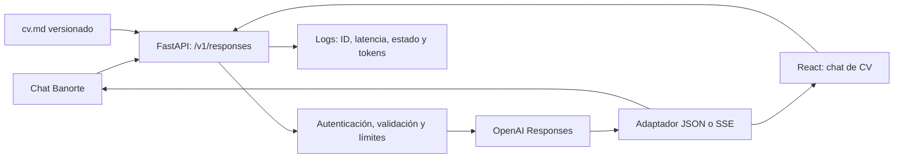

# Arquitectura y decisiones

## 1. Aplicación independiente
HugoGPT tiene una API FastAPI y una interfaz React con Vite y Tailwind CSS.
Una imagen Docker compila el frontend y ejecuta el backend con un usuario sin
privilegios. La única dependencia externa en tiempo de ejecución es OpenAI;
la fuente del perfil está versionada junto al código.

## 2. Contexto completo en Markdown
El perfil es pequeño y cambia poco. Se carga una vez al arrancar, se versiona con
Git y se identifica por SHA-256 abreviado en respuestas, health y logs. Un cambio
de perfil requiere redeploy; es una limitación consciente que aporta trazabilidad.
No hay embeddings, ingestión, base vectorial ni riesgo de recuperar una sección
incorrecta por similitud. El costo es enviar el perfil en cada solicitud; si el
corpus o volumen crece, medir primero latencia/tokens y después considerar RAG.

El perfil distingue cifras declaradas en el CV, evidencia del código y datos
pendientes. La confirmación directa de Hugo fija Proceti/Simultrayd en diciembre de 2025 y el MBA en 2024, corrigiendo el CV adjunto. No se publica
teléfono privado ni identificadores personales en el Markdown.

## 3. Historial propiedad del cliente
El cliente reenvía los turnos; el backend es stateless. No se usa Firestore ni
`previous_response_id`. Esto simplifica operación y evita compartir conversaciones
accidentalmente. La UI limita historial a los últimos 30 mensajes y el backend
rechaza contexto excesivo. Recargar la página pierde la conversación.

## 4. Reutilizar el protocolo del proveedor
Se usa HTTP con httpx para conservar respuestas y eventos Responses del proveedor,
en lugar de reconstruir manualmente una secuencia SSE a partir de Chat Completions.
El adaptador elimina las instrucciones internas devueltas por el proveedor y
completa campos opcionales ausentes de algunas respuestas para el esquema público.
No se necesitan SDK de agentes ni tool calling para leer un único documento fijo.

El servicio no se limita a un chat genérico: tiene un objetivo profesional acotado,
fuente versionada, límites de entrada y consumo, políticas de respuesta y evaluación.
Las herramientas deben responder a una necesidad; aquí no aportan datos adicionales.

## 5. Seguridad proporcional
Token Bearer independiente de OpenAI, comparación constante, cuerpo y contexto
acotados, modelo y presupuesto controlados por servidor. Las instrucciones del
cliente se rebajan a datos de usuario. React muestra respuestas como texto, sin
HTML remoto. No se ejecutan herramientas enviadas por el cliente.

El prompt reduce riesgo de alucinación o inyección, pero no lo elimina. No afirmar
protección absoluta: medir con casos adversariales y revisar errores. La clave
compartida es apropiada para un evaluador y una demo; no sustituye usuarios y cuotas
individuales en un producto abierto a gran escala.

## 6. Operación y límites reales
Un worker y una réplica; límites globales en proceso, sin infraestructura extra.
Logs estructurados mínimos, hash del perfil y request ID para diagnóstico.
`health` es una comprobación de configuración; una credencial revocada puede pasar
health y fallar el smoke test. No confundir estado "ok" con evaluación funcional.

## Evolución si la demanda lo justifica
Cuotas por usuario con gateway compartido, presupuesto diario del proveedor,
evaluaciones de regresión antes de cambiar el perfil, métricas agregadas y alertas,
storage por usuario si se requiere retomar conversaciones y RAG solo con corpus mayor.
